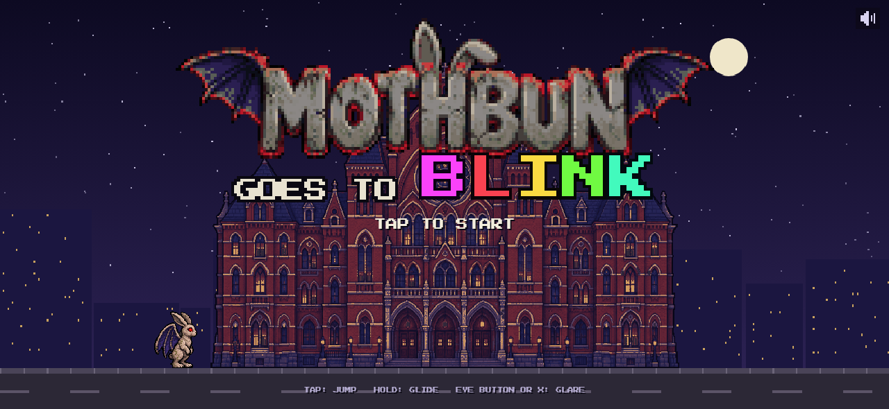
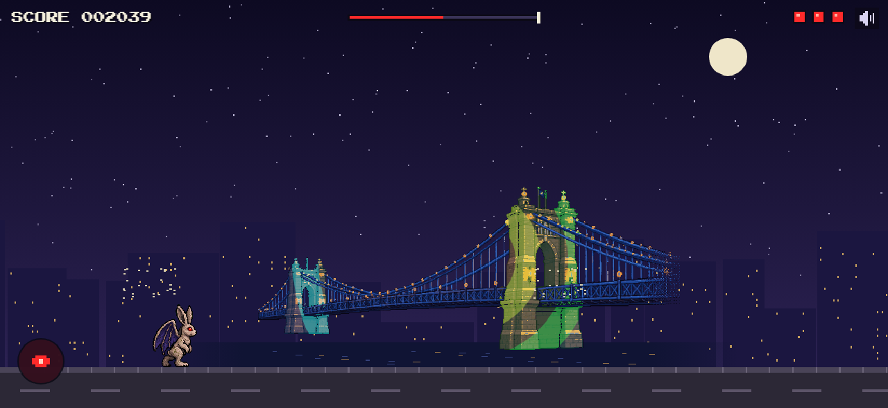
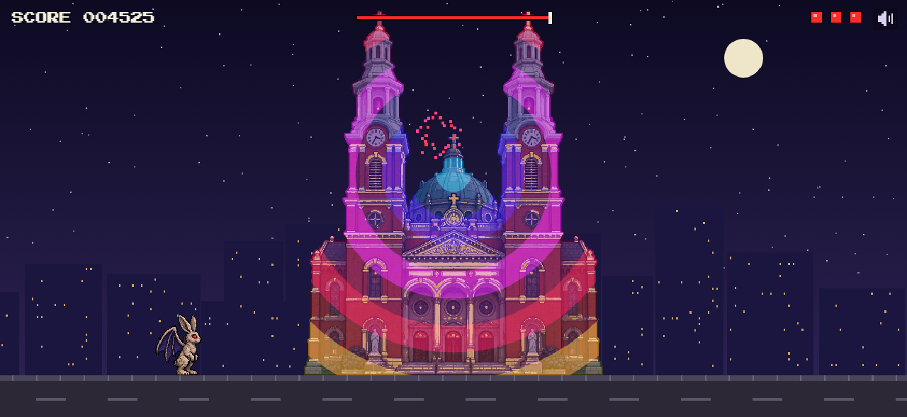

# Mothbun Goes to BLINK

A pixel art auto-runner starring a weathered concrete rabbit lawn statue dressed up as Mothman. Level 1 is set during BLINK, the Cincinnati and Covington light festival, with animated light projections playing across Music Hall and Mother of God Church and the Roebling Bridge lit up over the river between them.






**Play:** tap (or press space) to jump, hold to glide, and hit the eye button (or X) to fire a red-eye glare that knocks scooter riders off. Ride the roofs of pedal wagons and the streetcar, but don't run into them. Reach Mother of God Church for the closing light show. Best on a phone held sideways.

## How it's built

- TypeScript and a plain HTML canvas, no game engine. Vite for dev and builds.
- Art was generated in ChatGPT on a solid green background, then keyed, snapped to its pixel grid, scaled, palette-reduced, and night-graded with the Python scripts in `tools/`.
- Projections are drawn in code each frame, masked to the facade and screen-blended so they read as light. Windows are detected from the art by shape and switched on and off one at a time.

## Run it

```
npm install
npm run dev
```

Debug URL params: `?demo` plays itself, `?skip=30` fast-forwards 30 seconds.

Asset tools need Python with Pillow, NumPy, and SciPy:

```
python tools/clean_buildings.py
python tools/build_window_lights.py
python tools/clean_logo.py
python tools/clean_bridge.py
python tools/recolor_wings.py
python tools/clean_vehicles.py
```

## Credits

Background music: "Game 8-bit On" by moodmode (Pixabay, royalty-free).
